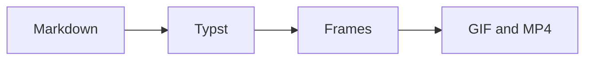

# The ==same deck==, now a film

**Markdown in, a GIF and an MP4 out**

---

# What a key press becomes

- a scene of the film
+ with a build-in of its own
+ and a hold after it

---

# Numbers count up

:::{metrics}
4 | formats
7 | transitions
:::

One palette from the stills; only changed pixels are stored.

---

# A diagram lights up



---

# Code stays code

```rust
let rendered = flipkit::render(&loaded, &options, outputs)?;
let cards = rendered.cards()?;
```

---

# Thanks

`flipcard slides.md --gif --mp4`

Note: The closing card. Notes never appear in the film.
